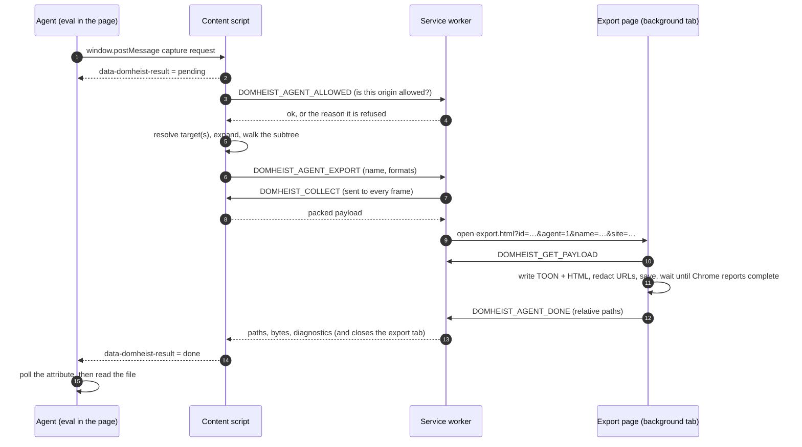

# Driving DOM Heist from a coding agent

The agent bridge lets an agent that can run JavaScript in a page (Claude in Chrome,
Playwright, Puppeteer, a devtools console) capture elements without clicking the toolbar.
This page is the practical guide; the option table is in the README.

A person picking by hand sees the hover box before clicking and looks at the result. An
agent sees neither, so the bridge gives it three checks instead: **preview** before
capturing, **expect** on what was captured, and a **fingerprint** to catch a capture that
did not change.

## How the bridge works

### Why messages

An agent driving a browser can run JavaScript in a page, but it cannot press the DOM Heist
toolbar button or keyboard shortcuts, and Chrome does not let one extension call another.
What the agent's script and DOM Heist's content script do share is the page itself. Chrome
runs a content script in an *isolated world*: it sees the same DOM as the page's own
scripts, but not their variables. Two things cross that boundary, and the bridge uses one
for each direction:

| Direction | Channel | Why this one |
|---|---|---|
| Agent → DOM Heist | `window.postMessage(...)` | A message event reaches every listener in the tab, content scripts included. It is the standard way for code the browser keeps apart (a page and an embedded frame, say) to exchange data. |
| DOM Heist → agent | the `data-domheist-result` attribute on `<html>` | A message is gone once delivered, and an agent's eval call returns before the capture finishes. An attribute stays on the page until the next request, so the agent can come back and read it. |

The content script also posts the result as a `{ __domheistAgent: 'result' }` message, for
callers that can stay and listen.

### Listening

When a page loads, the content script registers a single `message` listener on the top
frame's `window`. It does nothing until a message arrives; there is no polling on the
extension's side. Many sites post messages of their own (embedded players, payment frames,
chat widgets), so the listener ignores everything except messages that:

- come from the page's own window (`event.source === window`), not from a frame or another
  window, and
- carry `__domheistAgent: 'capture'`.

### The round trip



1. **Request.** The agent clears the old result and posts the request. The eval call
   returns immediately.
2. **Pending.** The content script refuses a second request while one runs. Otherwise it
   writes `{"id":…,"status":"pending"}` on `<html>`.
3. **Gate.** The content script asks the service worker whether this origin is allowed.
   Content script ↔ worker traffic uses `chrome.runtime` messaging, which the page cannot
   see or forge. The worker checks again on export, using the tab URL Chrome reports.
4. **Resolve and capture.** The target is found (`selector`, `selectors`, `point`,
   `hovered`, `fullPage`) and, unless `exact`, expanded like a click. The subtree is walked
   through the normal pipeline: computed styles, hover rules, pseudo-elements, form state,
   fonts, frames and pixel recovery. A `preview` request stops here and writes
   `status: "preview"` without saving. A capture computes `fingerprint`, `sameAsLast` and
   `missing` from what it captured.
5. **Collect.** The worker asks every frame in the tab for its payload. The frame holding
   the selection packs it (shared classes, layout wrappers, dropdown wiring, fonts). The
   worker merges frames and fetches font binaries.
6. **Write.** The worker opens the export page in a background tab, so the captured page
   keeps focus. It writes the TOON and a standalone HTML file, redacts sensitive URL
   parameters, and saves to `Downloads/domheist/<site>/<name>.*`, overwriting a previous
   capture of the same name.
7. **Report.** The export page sends the paths to the worker, which closes the tab and
   answers the content script. The content script writes the final result on `<html>`.
8. **Read.** The agent's next poll sees `done` and moves on to the file.

### Knowing it finished

`chrome.downloads.download` only *starts* a download. For each file, the export page polls
`chrome.downloads.search` every 120 ms and records the file only once Chrome reports it
`complete`. A download that is interrupted, or not complete within 15 s, is cancelled. If any
requested file was not saved, the result is `status: "error"` with
`downloads did not complete: <formats>`. So `status: "done"` means every requested file is on
disk. If the export page itself fails, it reports the error at once instead of letting the
worker wait out its timeout.

An agent should accept a result only when:

- `id` matches the request it sent, so it is not an earlier result;
- `status` is `done` and `paths` has the format it asked for;
- `missing` is empty and `sameAsLast` is `false`.

Then confirm the file from the shell (`ls ~/Downloads/domheist/<site>/<name>.toon`, or let
`scripts/agent-import.sh` fail if it is absent). Paths are relative to the downloads
folder, so the page never learns the account name; the agent adds the folder itself.

Every stage has a deadline, so a stall ends in `status: "error"` instead of `pending`
forever:

| Stage | Deadline |
|---|---|
| Tab screenshot for pixel recovery | 5 s, then placeholders are kept |
| Each download reaching `complete` | 15 s |
| Worker waiting for the export page | 170 s |
| Content script waiting for the worker | 180 s |

## 1. Allow the site

Local development hosts work out of the box. For any other site, open the DOM Heist popup
on that site and switch **Agent captures on this site** on. A site that is not allowed gets
no reply at all (so a page cannot detect DOM Heist): an agent sees the same silence as when
DOM Heist is not installed. An allowed site matches only its exact origin, port included; the
local hosts match on any port.

## 2. Find and mark the element

Read the page first (an accessibility snapshot, or a short script listing candidates with
their size and text). Then mark the element; a marker attribute is more reliable than a
long generated selector. Give the marker a name containing `domheist-`: the capture skips
every such attribute, so the marker never appears in the TOON or HTML.

```js
document.querySelectorAll('[data-domheist-target]').forEach((e) => e.removeAttribute('data-domheist-target'));
// e.g. the smallest element that contains both the title and the last button
el.setAttribute('data-domheist-target', '1');
```

## 3. Preview it

```js
document.documentElement.removeAttribute('data-domheist-result');
window.postMessage({ __domheistAgent: 'capture', id: 'p1', preview: true,
  selector: '[data-domheist-target="1"]', exact: true,
  expect: { text: ['Shipping address', 'Place order'] } }, '*');
```

The result (`status: "preview"`) carries a `summary`: the box, whether the target is
`hidden` or `partlyOffscreen`, its `headings`, its `controls` with their labels, and the
first 200 characters of its text. `missing` lists expected text that is not inside. The
target stays outlined for `previewMs` (default 4 s), so a screenshot shows exactly what
would be captured. Nothing is saved.

Several elements: `selectors: ['#a', '#b']` takes them together, like Shift+Click.
`combine: 'ancestor'` takes their nearest common parent instead. Each target is outlined
and numbered.

## 4. Capture and check

Send the same request without `preview` and with a `name`, then poll one attribute (it
stays short enough for tools that truncate eval output):

```js
document.documentElement.getAttribute('data-domheist-result')
// {"id":"c1","status":"done","paths":{"toon":"domheist/localhost-3000/checkout.toon",…},
//  "missing":[],"fingerprint":"9c1e04af","sameAsLast":false,"targets":[…]}
```

- `missing` is checked against the **captured** tree, ignoring case (so `text-transform`
  doesn't matter) and whitespace (so a label split across elements matches as it does in the
  preview), and text that was hidden at capture time is missing even though it is in the
  page source.
- `sameAsLast: true` means this capture equals the previous one: the menu you meant to
  capture had already closed, or the page had not updated yet. Retake it.
- `done` is only written once Chrome reports the download complete; see *Knowing it
  finished* above.
- Errors: `a capture is already running` (one at a time), `target not found`,
  `no element matches: …` (with `missing`), `invalid selector: …`, `unknown format: …`,
  `downloads did not complete: …`, timeouts.
- A selection you were making in the picker is set aside during an agent capture and put
  back afterwards; an agent capture only ever saves what it selected. Wait for each
  result before sending the next request: the attribute holds only the latest answer.

Polling the file from a shell (`ls ~/Downloads/domheist/<site>/<name>.toon`) is often more
reliable than looping in page JavaScript: long in-page loops can time out the automation
tool's eval call.

## 5. Move it into the project

```bash
scripts/agent-import.sh checkout path/to/captures
# DOMHEIST_SITE=localhost-3000 …   take it from one site's folder
# DOMHEIST_REDACT='mysessionkey' … also blank the app's own session parameter
```

The script takes the newest capture of that name, moves it, and prints the TOON's section
outline (`## Meta / Styles / Hover Styles / Pseudo Styles / Structure`) with line numbers.
Read `Structure` first, then only the style classes it uses.

## Tips from real use

- **Re-define helpers after navigation.** Page-swapping apps replace `window`, so a helper
  function defined in one eval is gone after the next navigation.
- **Visible-text matching:** many enterprise UIs render non-breaking spaces; match text
  with `/A\s+B/`, not `includes('A B')`. `expect` already normalizes whitespace.
- **Never "nudge" a stalled capture with a key press** — a key press lands in whatever
  input has focus.
- **Pick the container deliberately.** A `form` can be either too small (missing the
  title) or the whole page. Preview it and check the headings and controls it lists.
- **Menus rendered elsewhere.** Many apps attach an open dropdown to the end of `<body>`,
  outside the field's container. Capture the open menu as its own target.
- **Exporting data that isn't on screen:** to save structured text (a long list read across
  pages), put it into a temporary `<pre>` element, capture that element, then remove it.
- **Sessions in URLs:** captured `href`s carry whatever the page put there. The built-in
  redaction covers common names; add the app's own session parameter to `redactParams`
  (or `DOMHEIST_REDACT`) before committing captures.
